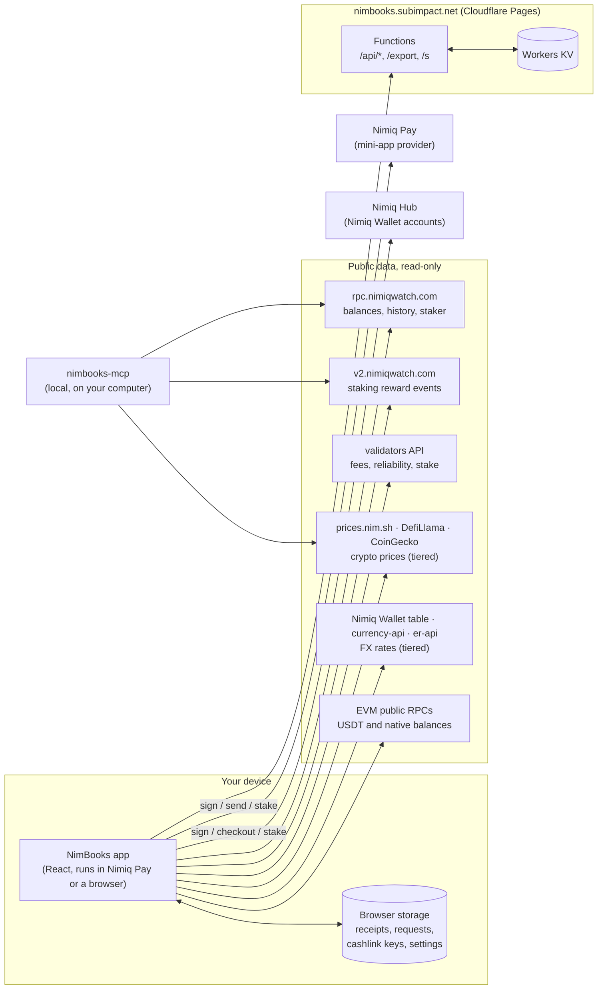

# NimBooks architecture

NimBooks is a client-side app. Your wallet signs, the public Nimiq chain is the
ledger, and the app reads the two together on your device. A handful of small
Cloudflare Pages Functions handle the few jobs a browser can't do on its own:
file downloads inside Nimiq Pay's WebView, short links, and the public usage
count. Everything on this page is in this repository, server code included.



## Two ways in, one app

| | Nimiq Pay (phone) | Nimiq Hub (any browser, Nimiq Wallet accounts) |
|---|---|---|
| Connect | `@nimiq/mini-app-sdk` 0.2.4 `listAccounts()` | `@nimiq/hub-api` sign-in |
| Pay or send | `sendBasicTransaction(WithData)` | Hub checkout |
| Sign a receipt | `sign()` | Hub `signMessage` (Nimiq Signed Message) |
| Stake, unstake, retire, withdraw | the SDK's staking calls; Pay builds and signs | NimBooks builds the transaction with `@nimiq/core` (wasm, loaded only here) and the Hub signs it |
| Errors | `NimiqProviderError`, shown with Pay's own reason | Hub errors, shown the same way |

Provider calls live in one file, `src/lib/wallet.ts`. The rest of the app
never talks to a wallet directly. A read-only **sample wallet** (demo mode)
runs the whole UI on a real public address, with no signing.

## Code map

```
src/
├── App.tsx              Main app: Overview, History, Receipts, Request, Export;
│                        #/stake opens the stake panel from a share link
├── EarnCard.tsx         Top of Overview: what the stake earns, or could
├── YieldCalculator.tsx  "See the maths": projection, chart, year table
├── Analytics.tsx        Daily net flow and balance trajectory (pure SVG)
├── Portfolio.tsx        Multi-address PDF report
├── InvoicePage.tsx      Public payment-request page   #/invoice/<request>
├── VerifyPage.tsx       Public receipt check          #/verify/<receipt>
├── Landing.tsx          Pre-connect feature explorer
└── lib/
    ├── wallet.ts        The only file that talks to Pay or the Hub
    ├── chain.ts         Nimiq RPC, price source names, validators, tx classification, yield
    ├── prices.ts        The price chain: nim.sh -> DefiLlama -> CoinGecko crypto tiers;
    │                    Nimiq Wallet table -> currency-api -> er-api FX tiers; NaN-as-unknown
    ├── yieldCalc.ts     Staking projection: compounding + issuance decline
    ├── stakingEvents.ts Reward rows from restake events
    ├── htlcFlows.ts     Nets Nimiq Pay's HTLC round trips out of real payments
    ├── payContracts.ts  Finds and archives every Nimiq Pay payment contract
    ├── stakeGate.ts     Which wallets unlock stake-gated features
    ├── statement.ts     Tax-year statements (daily UTC closes)
    ├── tax.ts, taxCsv.ts FIFO gains, staking income, Koinly/CoinTracking/CTC CSVs
    ├── receipt.ts       Receipt encode, Ed25519 verify, signer binding, chain check
    ├── invoice.ts       Payment requests: exact Luna maths, link encoding
    ├── stakeLink.ts     Stake links: parse/build #/stake?amount=…&validator=…
    ├── cashlink.ts      Cashlink format, byte-for-byte with the Hub
    ├── backup.ts        Export/restore of everything on the device
    ├── connectCount.ts  Consent for the public wallet count
    └── backupNudge.ts   "Back up now" after device-only data is created

functions/               Cloudflare Pages Functions (see "Server side")
mcp/                     nimbooks-mcp, the local AI server (published from subimpact/nimbooks-mcp)
test/                    Node oracles and Firefox probes
```

## Server side

There is no database of users or their books. The Functions are:

| Route | Job | Stores |
|---|---|---|
| `POST /api/track-connect` | Counts a connected wallet, only after consent | KV `wallet:<sha256>` record + `stats:summary` totals |
| `POST /api/forget-wallet` | Deletes that record when the owner opts out | (deletes) |
| `GET /api/stats` | Public numbers for the landing pill | (reads) |
| `GET /api/supporters` | Donations to the support address, names by consent | KV summary, refreshed every 5 min |
| `POST /api/shorten` | short.io link for receipt and request share links | nothing (short.io holds the link) |
| `POST /api/export-link` | Short link for a CSV export | KV, deleted after 48 h |
| `GET /s/<slug>.csv` | Serves that export | (reads) |
| `GET /export/<name>.csv` | Echoes a CSV carried in the URL as a download | nothing |

The two short-link routes only accept requests from the app's own origin
(`functions/_lib/fromApp.ts`); the counter routes accept only a checksum-valid
Nimiq address. Secrets (short.io key, Matrix token) are
Cloudflare Pages secrets and never reach the client bundle. What is kept, and
why, is spelled out in [PRIVACY.md](PRIVACY.md).

## How the main flows work

**Fiat prices.** `prices.ts` runs a tiered chain so the Total value tile is
never reduced to $0.00 by one busy source. Crypto USD prices climb
prices.nim.sh (Nimiq's own price service: NIM, ETH, MATIC, with USDT at
$1), then DefiLlama in one consolidated call, then CoinGecko (USD only)
- each tier is accepted only when it returns a plausible NIM price (any
answer at or above $0.01 is bad data, not a rally), and assets a winning
tier left out are filled from the next tier that has them. FX rates for the
148 display currencies are the Nimiq Wallet's own exchange-rate table
(Firestore), with anything missing filled from the currency-api data via
jsDelivr, then ExchangeRate-API. A ~4 s timeout per request; every
last-good result is cached with its timestamp (`nimbooks:rates` for
per-asset tables, 5 minutes fresh; `nimbooks:fx` for the USD table, 60
minutes fresh) and reused at any age when everything live fails - if the
price is older than 30 minutes the tile shows "as of HH:MM". When no price
exists at all, an unknown rate is stored as NaN, not 0, and the UI says
"Price unavailable" instead of showing $0.00 for a non-zero balance.

**Balances and history.** The app reads the address's balance, transactions
and staker record from `rpc.nimiqwatch.com`. Nimiq Pay pays out of an HTLC
contract that it replaces often, so the app finds every contract the
wallet itself funded, merges their histories into History, and archives each
settled one on the device (it can no longer change, so it is read once).
In Analytics and in statements, funding a contract and getting the NIM back
are shown as internal transfers, not as payments, and stakes made from a contract count as
staking, not as money sent. If Nimiq Pay cannot say whether a payment went through, the app
says so, locks the form against a second send and checks the chain. History
refreshes on a 10-second heartbeat. Staking rewards come from Nimiq Watch's
restake events and appear as one row per validator per day, back to January
2025: fetched in calendar chunks (closed years, the year to date, the running
month) with closed periods cached on the device. Only a validator pays a reward:
each sender is checked once against Nimiq Watch's validator record, because the
feed also lists stake that arrives through a contract (a Nimiq Pay stake goes
through an HTLC) as a restake.

**Earning numbers.** A validator's net yield is one year of protocol emission
÷ total network stake × (1 − fee), the same formula Nimiq's own wallet uses
(`annualRewardFor` in `chain.ts`). `yieldCalc.ts` projects it month by month
along the protocol's supply curve (issuance falls about 11.8% a year) and
compounds for pools that restake. The Earn card and the calculator share that
code, and `test/yield-oracle.cjs` pins it.

**Staking.** Stake → deactivate (cooldown to the next election) → retire
(after one reporting epoch) → withdraw. A first stake needs 100 NIM, the
protocol's `MINIMUM_STAKE`. Each step waits for the chain before it reports
success.

**Payment requests.** The whole request (payee, Luna amount, memo, expiry) is
in the URL fragment, so no server holds it. The payer's transaction carries
`nimbooks:invoice:<id>` as data, and the payee's History marks the request paid
when that transaction appears on-chain.

**Signed receipts.** The wallet signs `{txHash, amount, memo, timestamp, …}`.
The verify page checks the Ed25519 signature, derives the signer's Nimiq
address from the public key, requires it to be the sender or recipient, and
cross-checks the transaction on-chain. The signature itself is not on-chain:
it lives in the receipt link and on the device that signed it.

**Cashlinks.** The key is generated on the device and stored there before any
NIM moves. The funding transaction carries the Hub's own cashlink tag, so
`hub.nimiq.com/cashlink` can claim it. Unclaimed links can be reverted.

**Exports inside Nimiq Pay.** Pay's WebView can't save files, so a CSV becomes
a link (the long `/export` URL with the gzipped CSV inside it, or a 48-hour
`/s/<slug>` short link) that any browser downloads.

## Security choices

- **No keys, ever.** NimBooks never sees a private key. The only key material
  it handles is a cashlink's own key, generated on the device for that link.
- **A strict Content Security Policy** (`public/_headers`) lists every origin
  the app may call. An injected script has nowhere to load from or send to.
- **Exact amounts.** Luna maths uses integers end to end, and CSV exports are
  safe against formula injection.

## Testing and deploys

- `test/*.cjs`: node oracles (yield maths, HTLC netting, transaction reads,
  supporters, stake gate) and Firefox probes (regression, landing, live
  refresh, portfolio).
- `mcp/test/`: server, classification, statement, backup and invoice-parity
  tests for the MCP package.
- Deploys are direct uploads with `wrangler pages deploy`. A change is tested
  on a preview branch (`preview-*.nimbooks.pages.dev`) inside Nimiq Pay before
  it reaches the production branch. `main` is protected against force-push and
  deletion.
